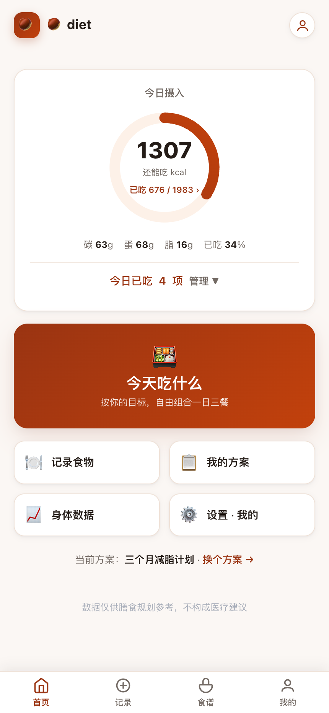
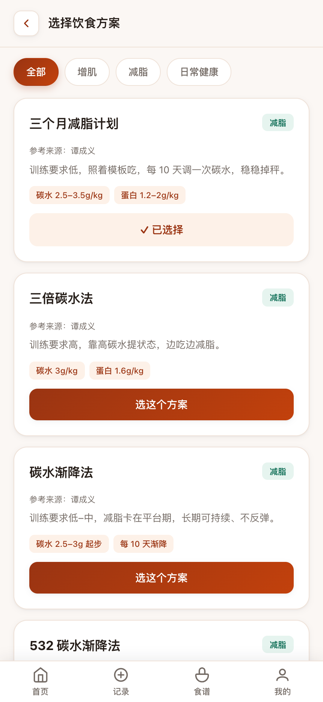
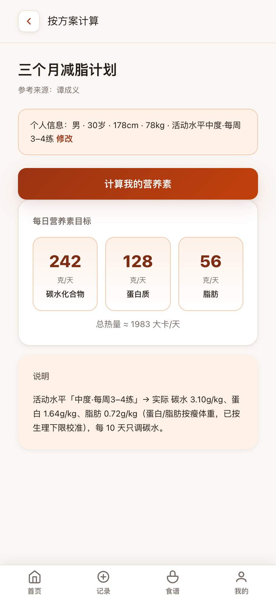
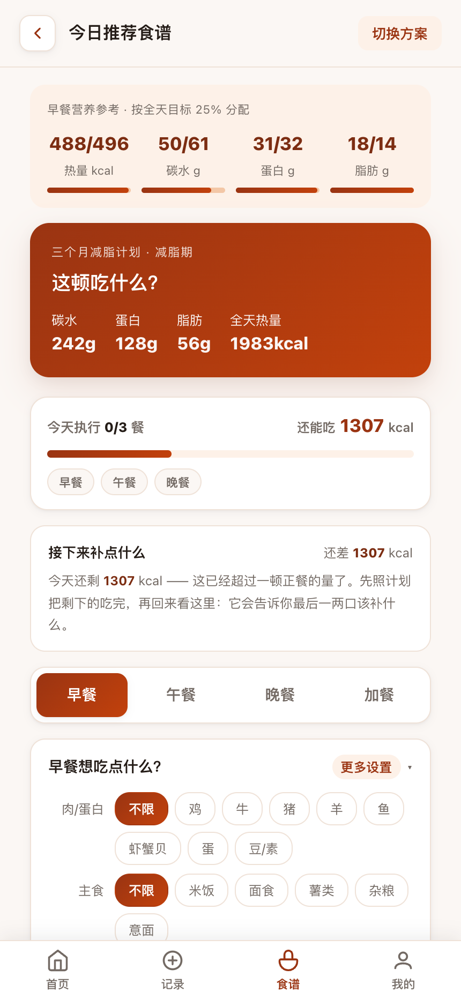
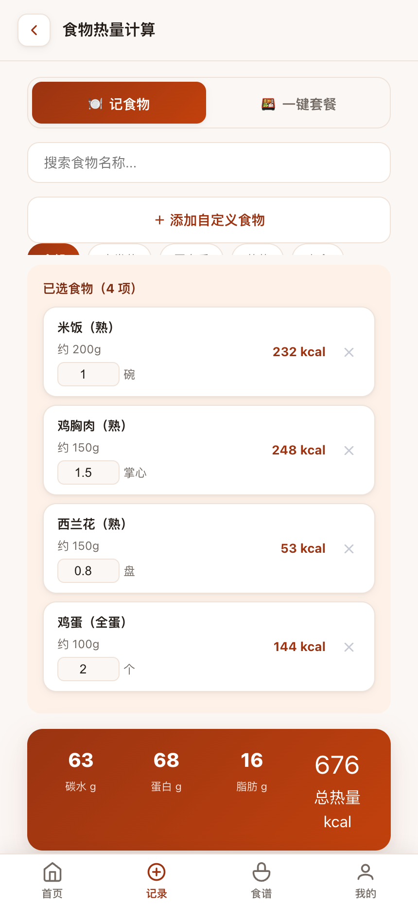

# 🌰饮食 · 健身饮食规划 WebApp（Fit Diet）

**在线直接用 → https://ches1nut.github.io/lizi-diet/**

一个纯前端、零依赖的健身饮食规划工具。打开网页就能用，数据只存在你自己的浏览器里（localStorage），不上传任何服务器。

<p align="center">
  
  
  
  
  
</p>

## 核心功能

- **方案库**：按目标（增肌 / 减脂 / 日常健康）筛选方案、查看详情、最多 3 个方案横向对比
- **问卷推荐**：回答目标 + 个人信息 + 专属分支问题，自动推荐最匹配的方案
- **营养计算**：输入个人信息，计算 BMR、TDEE、目标热量与三大营养素克数
- **食谱自由组合**：按「今天想吃牛肉 / 鸡 / 鱼 / 蛋…」选偏好，早 / 午 / 晚三餐独立切换，「换一换」只换当前餐；一键把当前餐加入今日摄入
- **食物热量计算**：搜索（模糊匹配）/ 分类浏览；支持「1 个 / 2 碗 / 半杯」的份量单位输入；含品牌产品库与手动新增的自定义食物；**「常吃 / 最近 / 收藏」快捷复用入口**（无数据时该行不显示）
- **今日摄入追踪**：首页进度环实时展示已摄入 / 目标热量与三大营养素；记录条目会保存**当时的营养快照**，食物库后续改动不会让历史数字漂移
- **身体数据**：记录体重 / 体脂变化
- **我的面板**：本地保存个人信息与当前方案，可导出 / 导入全部本地数据、清空全部本地数据
- **数据备份**：一键把**全部**本地数据导出为 JSON、也可导入恢复；换设备可整体迁移

## 数据规模

- 基础食材 + 家常菜 + 快餐小吃：**910 种**（每 100g 营养数据）
- 品牌连锁产品：**202 款**（官方数据，未公布字段置 `null` 不编造）
- 合计：**1112 种食物**，18 个分类
- 份量换算表：覆盖全部 910 种基础食材的「个 / 碗 / 杯 / 勺 / 掌心」等常见单位

### 数据来源分级

同一个数字背后的可信度并不一样，所以界面上会显式标注——用户不该把估算值当成实测值：

| 标记 | 含义 | 说明 |
|---|---|---|
| （无标记） | **基础食材** | 参考《中国食物成分表》等公开数据的常见范围，按每 100g 可食部计。内置数据用**区间**而非单点值，因为同一食材会因品种、生熟、烹饪方式浮动 |
| 官方 | **品牌公布** | 品牌官方公布的营养信息，按「份」计算。规格不同（去糖 / 加酱）会有出入，可用热量微调修正 |
| 估算 | **外食 / 复合菜** | 家常菜、餐厅菜的油盐用量各家差别很大，按常见做法估算（名字带「（估）」的同类） |
| 自定义 | **你自己录的** | 以你填写的数值为准 |

标记全部**从数据结构推导**，不写死食物名单——硬编码的名单一定会随食物库增删改名而失效。

## 计算依据（均有文献出处）

- 基础代谢：**Mifflin-St Jeor 公式**（Mifflin et al., *Am J Clin Nutr* 1990; 51(2):241-247）
- 蛋白质：**ISSN 2017 立场声明**（增肌 1.6–2.0 g/kg，减脂期可达 2.3–3.1 g/kg）
- 碳水供能比：**中国卫健委《中国居民膳食指南》**（增肌期 60–65%，约 4–6 g/kg）
- 增肌热量盈余：**ISSN 2017**（300–500 大卡/天）
- 活动系数：**FAO/WHO/UNU 2001** PAL 分级（1.2–1.9）
- 蛋白 / 脂肪按**去脂体重**而非总体重计算（缺省按 20% 体脂折算，未填体脂时输出与按总体重一致）

## 使用方式

### 在线使用

直接访问 **https://ches1nut.github.io/lizi-diet/**

### 本地运行

双击 `index.html` 即可（食物库是本地 `foods.js`，无需服务器）。若要起静态服务器：

```bash
# Python
python3 -m http.server 8000
# 然后访问 http://localhost:8000

# 或 npx http-server（本项目开发常用端口 9120）
npx http-server -p 9120 -c-1
```

## 项目结构

```
fit-diet/
├── index.html      # 主程序（结构 + 样式 + 逻辑，单文件）
├── foods.js        # 内置食物数据库 + 份量换算表 + 组合引擎配置
├── screenshots/    # README 展示图（5 张，430×932 @2x）
├── LICENSE         # MIT
├── README.md
└── .gitignore
```

## 技术形态

- 纯前端、零依赖、无构建——没有 `package.json`，没有打包步骤
- 数据层与 UI 分层：`foods.js` 只放数据（`FOODS` / `BRAND_FOODS` / `PORTIONS` / `FOOD_POOLS`），`index.html` 放逻辑与样式
- 导航：`go(name)` 切换 `.screen` 视图 + 底部固定 TabBar（首页 / 记录 / 食谱 / 我的）
- 数据持久化：localStorage（个人信息 / 当前方案 / 每日摄入 / 自定义食物 / 身体数据）；存储不可用时（隐私模式、沙箱预览）自动退化为会话内存，功能不报错
- 餐单生成：目标热量驱动 + 角色化求解（主食 / 蛋白 / 蔬菜 / 脂肪各自反解克数）

## 开发约定（重要）

- **数据准确性铁律**：品牌产品数据只放官方有据可查的，官网没公布的字段置 `null`，不编造。
- **语法自检**：每次改动后运行 `node --check foods.js` + 提取 `index.html` 内联 `<script>` 块做 `new Function` 语法校验。
- **分类原则**：品牌 / 连锁用品牌名（兰州拉面、沙县小吃、瑞幸咖啡…），无法对应连锁的按品类归（卤味、煎饼 / 饼类、米饭套餐…）。
- **来源标记不写死名单**：判定必须走关键字 / 数据属性推导，否则食物库一改名标记就会失效。
- **部署**：仅当明确说「上传 / 发布」时才 push GitHub Pages。

## 刻意没做的事

开源项目里「不做什么」和「做什么」一样重要，记下来免得重复讨论：

- **拍照识别热量**——未接入。图片识别热量在东亚菜上的误差很大（复合菜尤甚），给出的数字会伪装成实测值，与本项目「让用户知道数字有多可信」的前提冲突；接入云端多模态服务还会破坏「双击即用、零依赖、数据不出本机」这三条。（记录页原本的拍照入口已移除；此处「未接入」指**不打算接入**，不是「待实现」。）
- **全库食物配图**——未做。中式家常菜没有可合法使用的图源（公开数据集多源自美食社区，授权链条不干净），且会给仓库带来几十 MB 的体积。
- **账号与云同步**——未做。一旦有服务端就同时失去「零依赖」和「数据不出本机」。

## 后续规划

- [x] 记录页拆分（「我的食物」独立成屏），降低单屏信息密度
- [x] 记录条目保存当时的营养快照，避免食物库改动后历史数字漂移
- [x] 数据导出 / 导入（JSON），方便备份与换设备
- [x] 常吃 / 最近 / 收藏的食物复用入口
- [ ] 接入完整食物数据库（公开 API + 本地录入）

## License

[MIT](LICENSE)
